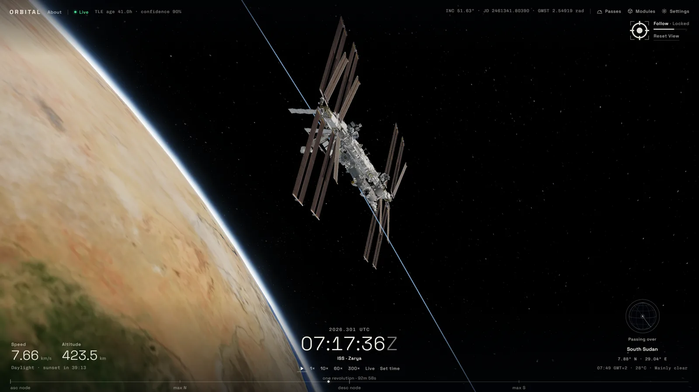
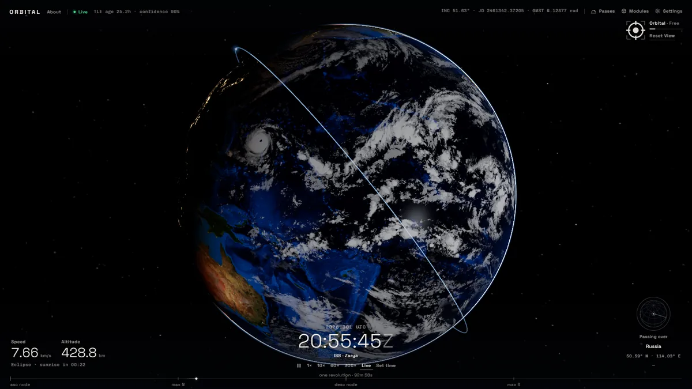
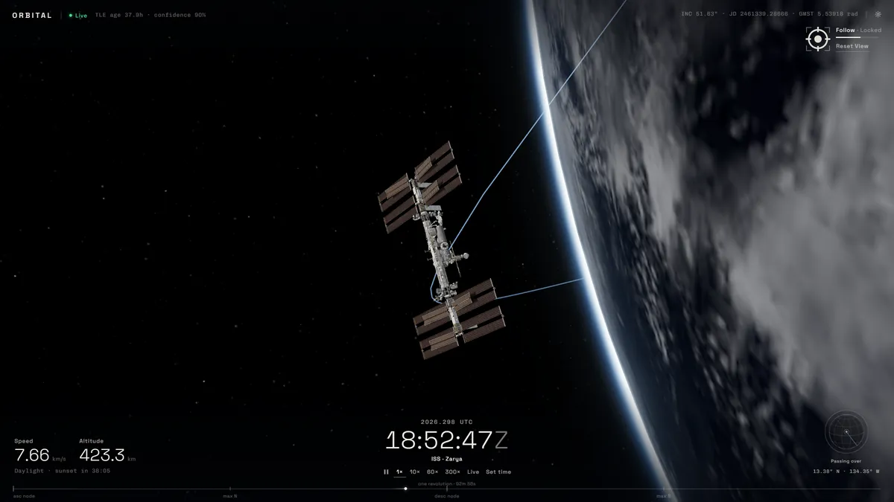
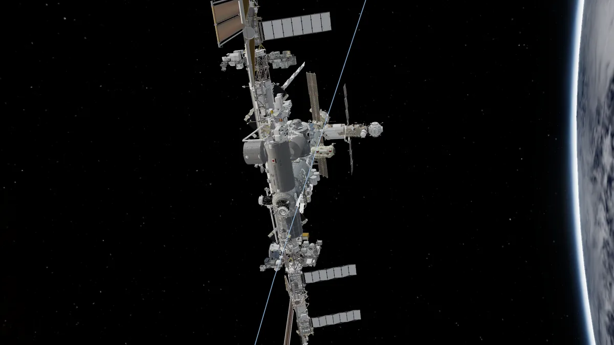
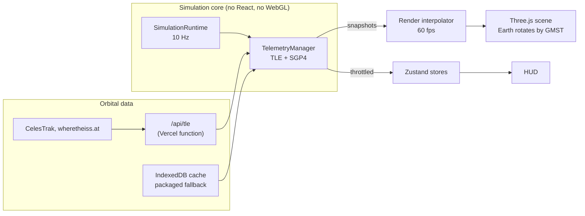

# Orbital

**A real-time 3D view of the International Space Station, computed in your browser from public orbital data.**

[](https://github.com/slklnarnv/orbital/actions/workflows/verify.yml)
[**Live demo →**](https://orbitaliss.vercel.app)



Orbital propagates the station's published orbital elements with SGP4, places
it in an inertial frame above an Earth that turns with sidereal time, and
renders NASA's IGOAL model of the station with its solar arrays tracking the
Sun. Everything you see is derived live: position, speed, daylight, the ground
point below, and the station's attitude.

| | | |
|:-:|:-:|:-:|
|  |  |  |
| Earth overview: terminator, city lights, orbit | Follow: tracking the station at the limb | Inspect: the full 2.7M-triangle model |

## What you are looking at

- **Where the ISS is.** NORAD publishes a *two-line element set* (TLE) for
  the station about daily: six orbital elements plus a drag term, frozen at an
  epoch. The SGP4 model turns a TLE into position and velocity at any instant.
  The error is roughly a kilometre at the epoch and grows by kilometres per
  day, so the HUD shows the element set's age and a confidence score.
- **Why the ground track drifts.** The orbit is fixed in an inertial frame
  (TEME) while Earth rotates beneath it, by Greenwich Mean Sidereal Time.
  One revolution takes about 93 minutes, so each pass crosses the ground
  about 23° further west, and the 51.6° inclination bounds the track between
  51.6° north and south.
- **Day and night.** The station spends up to about 36 minutes of each orbit in
  Earth's shadow, depending on the orbit's angle to the Sun. Orbital models
  the penumbra, so sunset is a fade rather than a switch, and counts down to
  the next sunrise or sunset.
- **How it flies.** The ISS holds an Earth-facing attitude (LVLH). The solar
  arrays turn on their rotary joints (SARJ and BGA) to face the Sun, and the
  radiators turn edge-on to it. Orbital drives these joints from the same
  geometry.
- **Scale.** At true scale the 109 m station would be smaller than a pixel
  from a few hundred kilometres away, so it is drawn about 1,000× larger.
  Distances and the Earth are to scale (1 world unit = 1 km).

## Features

- SGP4 propagation at 10 Hz, decoupled from React and the render loop, with
  smooth interpolation to the display rate
- Time controls: pause, 1×–300×, absolute UTC seeks, and a scrubbable
  revolution tape
- Custom GLSL Earth: day/night terminator, city lights, ocean glint, clouds,
  atmosphere
- NASA's IGOAL ISS model in two tiers: a fast level of detail for Follow and
  the full model below 200 km. It uses GPU-compressed (KTX2) textures,
  animated joints and sun-cast self-shadowing.
- Camera modes from planetary to close inspection, with one-click Locate
  flights and a reset to the overview
- Ground context: the country or ocean below, local time and weather, and a
  ground-track globe
- Optional HDR bloom, lens flare, 3D ground track and visibility footprint
- Works offline: packaged and cached orbital data, and an offline place index

## How it works



The simulation core owns the truth: a clock that can pause, accelerate or
seek, and orbital snapshots computed at 10 Hz. Rendering only reads those
snapshots. It interpolates between them every frame and mutates Three.js
objects directly, while the HUD receives throttled updates through Zustand.
TEME coordinates map to the scene as `(x, z, −y)`.

**Data resilience.** `/api/tle` races CelesTrak's two domains and
wheretheiss.at, validates the first answer and caches it at the edge. The
browser keeps the last good set in IndexedDB and ships a packaged fallback
that GitHub Actions refreshes twice a week. The HUD reports which source is in
use:

| Label | Meaning |
|---|---|
| Live | A CelesTrak set fetched within the last 24 hours |
| Cached | A set fetched within the last 7 days that is not Live |
| Fallback | Offline, propagating the packaged set |
| Recovery | Data missing or stale while bounded retries run |

New element sets blend in over two seconds, so a refresh never makes the
station jump.

## Controls

| Input | Action |
|---|---|
| Drag · scroll or pinch | Orbit · zoom (finer near Earth and the station) |
| Right-drag or two-finger pan | Move the pivot (releases tracking) |
| **Locate ISS** | Fly to the station and follow it |
| **Reset View** | Return to the Earth overview |
| `Space` · `H` | Pause or resume · hide the HUD |
| 1× 10× 60× 300× · Live · Set time | Time rate, return to wall clock, seek to a UTC instant |
| Revolution tape | Drag or click to scrub through the current orbit |
| Gear icon | Model quality, orbit style, bloom, lens flare, ground track, shadows |

## Getting started

Requires Node.js 22 or later.

```bash
git clone https://github.com/slklnarnv/orbital.git
cd orbital
npm ci
npm run dev          # http://localhost:5173, /api/tle served by the real handler
```

```bash
npm run verify       # release gate: asset budget, shaders, types, lint, unit tests, build
npm run test:e2e     # Playwright smoke suite against the production preview
npm run preview      # production bundle, with the production security headers
```

Stack: React 18, TypeScript, Vite, Three.js r170 with React Three Fiber and
drei, `satellite.js`, Zustand, Tailwind CSS, Vitest and Playwright. The site
deploys to Vercel as static files plus the `/api/tle` function.

```text
api/            /api/tle function
src/core/       clock, runtime, SGP4, telemetry, geo lookup (pure, unit-tested)
src/rendering/  Earth, ISS model and joints, post-processing, GLSL shaders
src/interaction/ camera state machine and flights
src/ui/         HUD
scripts/        ISS model and LOD build pipeline, data refresh, CI gates
tests/          Vitest unit tests (node) and Playwright e2e
docs/           design notes, model forensics, roadmap
```

## Accuracy and limits

Orbital is a visualization, not a navigation or conjunction tool. Positions
are SGP4 estimates from public TLEs, not spacecraft telemetry, and degrade as
the element set ages. The Earth is a sphere of 6,371 km (geodetic math uses
WGS84). The station's attitude is modelled from its standard flight mode, not
measured.

## Documentation

- [`docs/NEXT_STEPS.md`](docs/NEXT_STEPS.md): current state and roadmap
- [`docs/HANDOFF.md`](docs/HANDOFF.md): camera, geo and HUD internals, and a debugging playbook
- [`docs/ISS_MODEL_CONTEXT.md`](docs/ISS_MODEL_CONTEXT.md): the model pipeline, rig contract and runtime loading
- [`docs/MODEL_AUDIT.md`](docs/MODEL_AUDIT.md): forensics of the ISS assets
- [`plans/PROGRESS.md`](plans/PROGRESS.md): the change ledger

## Credits and license

The ISS models are NASA's (IGOAL and NASA 3D Resources). The Earth and sky
imagery comes from NASA Blue Marble and Black Marble, place names from Natural
Earth, and weather from Open-Meteo. Orbital data comes from CelesTrak and
wheretheiss.at. NASA does not endorse this project. Full terms are in
[NOTICE.md](NOTICE.md).

The source code is [MIT-licensed](LICENSE).
